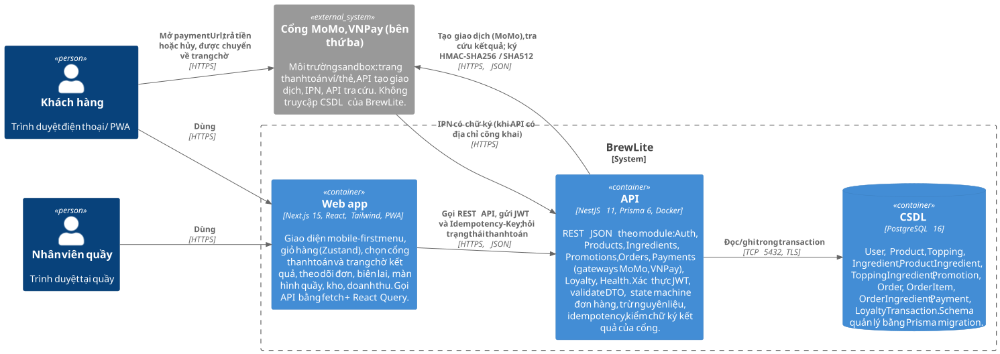
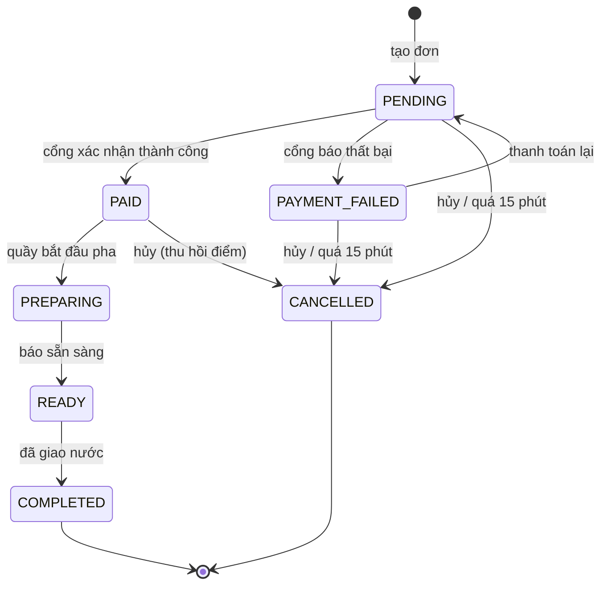

# BrewLite – đặt cà phê không tiền mặt

Bài tập lớn môn Công nghệ Phần mềm (Assignment 2), Trường Đại học Sài Gòn. Ứng dụng web/PWA giúp khách tự chọn đồ uống, thanh toán không tiền mặt qua cổng MoMo hoặc VNPay (môi trường sandbox) và nhận nước tại quầy; nhân viên quầy theo dõi đơn, cập nhật trạng thái pha chế, xem doanh thu và nhập kho nguyên liệu.

- **Công nghệ:** Next.js 15 (web, mobile-first/PWA), NestJS 11 + Prisma 6 (API), PostgreSQL 16, Docker, GitHub Actions.
- **Quy trình:** yêu cầu → mô hình hóa → kiến trúc → hai Sprint → CI/CD và triển khai; code được hiện thực từ tài liệu thiết kế trong `docs/`.
- **Phiên bản:** `v1.0.0` – xem [release notes](docs/release-notes.md).

## Chức năng

**Khách hàng**
- Xem Menu (món hết nguyên liệu hiện *Hết hàng*), xem chi tiết món, chọn size, topping, số lượng trong giới hạn số ly còn bán được.
- Giỏ hàng lưu trên trình duyệt: sửa số lượng, xóa món, nhập mã giảm giá.
- Đăng ký, đăng nhập; thanh toán qua MoMo hoặc VNPay sandbox, thanh toán lại khi thất bại, xem và in biên lai.
- Màn hình xác nhận, lịch sử và chi tiết đơn (tự cập nhật khi quầy xử lý); hủy đơn chưa pha; tích điểm thưởng.
- Dùng tốt trên điện thoại (khổ 375 px), cài được như ứng dụng (PWA).

**Nhân viên quầy**
- *Quầy*: đơn đã thanh toán theo nhóm, chuyển Đang pha chế → Sẵn sàng → Hoàn tất, hủy đơn đã thanh toán chưa pha.
- *Kho*: tồn từng nguyên liệu, số ly còn bán được của từng món, nhập thêm hàng.
- *Doanh thu*: giao dịch MoMo, VNPay, tiền đã vào, giao dịch cần hoàn tiền, biên lai.

**Hệ thống**
- Giá luôn do server tính; state machine chặn chuyển trạng thái đơn sai.
- `Idempotency-Key` chống tạo đơn và mở phiên thanh toán trùng; kết quả cổng báo lặp chỉ xử lý một lần.
- Trừ nguyên liệu theo công thức bằng optimistic locking: đặt đồng thời không vượt tồn kho.
- Đơn chưa thanh toán quá 15 phút tự hủy và trả nguyên liệu về kho.

## Công nghệ

| Thành phần | Công nghệ |
| --- | --- |
| Web | Next.js 15 (App Router, TypeScript), Tailwind CSS 4, Zustand, TanStack React Query, PWA |
| API | NestJS 11 (TypeScript), REST, class-validator, JWT, bcrypt |
| CSDL | PostgreSQL 16 + Prisma 6 (migration, seed) |
| Thanh toán | MoMo và VNPay, môi trường sandbox (không trừ tiền thật) |
| Kiểm thử | Jest (unit, integration), Vitest + Testing Library (component), Playwright (E2E) |
| DevOps | Docker Compose, GitHub Actions (CI/CD), GHCR, Render (API), Vercel (web), Neon (PostgreSQL) |

## Production

| Thành phần | URL |
| --- | --- |
| Web | https://brewlite-web.vercel.app |
| API | https://brewlite-api-wjwg.onrender.com – health check [`/health`](https://brewlite-api-wjwg.onrender.com/health) |

Lần truy cập đầu sau khi rảnh 15 phút có thể chờ khoảng 1 phút vì API chạy gói miễn phí của Render (rủi ro R-01).

**Tài khoản mẫu:** `khach@brewlite.vn` / `123456` (khách), `barista@brewlite.vn` / `123456` (nhân viên quầy). **Mã giảm giá:** `BREW10` (10%), `WELCOME20` (20%, đơn từ 100.000đ), `HETHAN` (đã hết hạn).

### Thử nhanh trên production

1. Mở https://brewlite-web.vercel.app trên điện thoại hoặc máy tính, chọn một món ở *Menu*, chọn size, topping rồi *Thêm vào giỏ*.
2. *Giỏ hàng* → nhập mã `BREW10` → *Thanh toán*; đăng nhập bằng `khach@brewlite.vn` / `123456`.
3. Chọn VNPay → trên trang của cổng trả bằng thẻ NCB (mục [Thẻ thử](#chạy-ở-máy-cá-nhân)) → quay về BrewLite, đơn sang *Đã thanh toán*, có biên lai.
4. Mở cửa sổ ẩn danh, đăng nhập `barista@brewlite.vn` / `123456` → *Quầy*: *Bắt đầu pha* → *Báo sẵn sàng* → *Đã giao nước*; trang đơn của khách tự đổi trạng thái.
5. *Kho*: xem nguyên liệu vừa bị trừ, nhập thêm hàng; *Doanh thu*: giao dịch vừa trả kèm mã giao dịch của cổng.
6. Thử tồn kho: *Cold brew* chỉ đủ 5 ly size S (4 ly M, 3 ly L); thêm quá số đó thì không đặt được.

## Chạy ở máy cá nhân

Yêu cầu: Docker Desktop và Internet (để mở trang thanh toán MoMo, VNPay sandbox). Chạy cả 3 dịch vụ (web, API, PostgreSQL) bằng một lệnh:

```bash
git clone https://github.com/PhucLee23/brewlite-assignment2.git
cd brewlite-assignment2
cp .env.example .env          # điền VNPAY_TMN_CODE, VNPAY_HASH_SECRET: khóa sandbox của nhóm, không commit
docker compose up -d --build
```

| Dịch vụ | Địa chỉ |
| --- | --- |
| Web | http://localhost:3000 |
| API | http://localhost:4000 (`/health`) |
| PostgreSQL | `localhost:5432`, user/mật khẩu/CSDL `brewlite` |

API tự áp migration và nạp dữ liệu mẫu khi khởi động. Dừng: `docker compose down`.

**Thử luồng thanh toán:** đặt món → *Thanh toán* → chọn MoMo hoặc VNPay → trang của cổng (sandbox, không trừ tiền thật). Trả xong, cổng chuyển về BrewLite và đơn sang *Đã thanh toán*; bấm *Hủy* trên trang cổng thì đơn báo thanh toán không thành công, giỏ hàng giữ nguyên.

| Cổng | Thẻ thử |
| --- | --- |
| VNPay | Ngân hàng NCB · số thẻ `9704198526191432198` · tên `NGUYEN VAN A` · ngày phát hành `07/15` · OTP `123456` |
| MoMo | Chọn thẻ ATM · số thẻ `9704000000000018` · tên `NGUYEN VAN A` · ngày phát hành `03/07` · OTP `OTP` |

Nhân viên (`barista@brewlite.vn`) có thêm *Quầy*, *Kho* (nhập thêm nguyên liệu) và *Doanh thu* (giao dịch, biên lai).

| Việc | Lệnh |
| --- | --- |
| Xem log API | `docker compose logs -f api` |
| Tắt, giữ nguyên dữ liệu | `docker compose down` |
| Bật lại | `docker compose up -d` |
| Build lại sau khi sửa code | `docker compose up -d --build` |
| Tắt và xóa luôn dữ liệu | `docker compose down -v` |

### Chạy từng phần khi phát triển

Cần Node.js 22.

```bash
docker compose up -d db                       # chỉ PostgreSQL
cd apps/api && npm ci && cp ../../.env.example .env
npx prisma migrate deploy && npx prisma db seed
npm run start:dev                             # API :4000

cd apps/web && npm ci && npm run dev          # web :3000
```

## Biến môi trường

Mẫu đầy đủ ở [.env.example](.env.example). Trên production các giá trị nằm trong GitHub Secrets, Render và Vercel ([docs/deployment.md](docs/deployment.md)).

| Biến | Nơi dùng | Ý nghĩa |
| --- | --- | --- |
| `POSTGRES_USER`, `POSTGRES_PASSWORD`, `POSTGRES_DB` | db | Tài khoản và tên CSDL của container PostgreSQL |
| `DATABASE_URL` | API | Chuỗi kết nối PostgreSQL |
| `PORT` | API | Cổng API, mặc định 4000 |
| `FRONTEND_URL` | API | Địa chỉ web được phép gọi API (CORS) |
| `JWT_SECRET`, `JWT_EXPIRES_IN` | API | Khóa ký JWT và thời hạn token |
| `VNPAY_TMN_CODE`, `VNPAY_HASH_SECRET` | API | Mã website và chuỗi bí mật VNPay sandbox (không commit) |
| `MOMO_PARTNER_CODE`, `MOMO_ACCESS_KEY`, `MOMO_SECRET_KEY` | API | Khóa MoMo; để trống thì dùng bộ khóa test công khai của MoMo |
| `PUBLIC_API_URL` | API | Địa chỉ công khai của API để cổng gọi IPN |
| `NEXT_PUBLIC_API_URL` | web | Địa chỉ API; được nhúng lúc build, đổi thì phải build lại web |

## Dữ liệu mẫu

| Loại | Giá trị |
| --- | --- |
| Tài khoản khách | `khach@brewlite.vn` / `123456` |
| Tài khoản nhân viên (STAFF) | `barista@brewlite.vn` / `123456` (có thêm *Quầy*, *Kho*, *Doanh thu*) |
| Mã giảm giá | `BREW10` (−10%), `WELCOME20` (−20%, đơn từ 100.000đ), `HETHAN` (đã hết hạn), `TAMNGUNG` (đang tạm ngưng) |
| Món ít hàng | *Cold brew* đủ nguyên liệu cho 5 ly size S, 4 ly M, 3 ly L; *Trà bưởi hồng* đang hết nguyên liệu |
| Menu | 15 món, công thức nguyên liệu trong [seed.ts](apps/api/prisma/seed.ts) |

## Kiểm thử

| Loại | Lệnh | Mã test |
| --- | --- | --- |
| Unit test API (tính giá, mã giảm giá, state machine, điểm thưởng, nguyên liệu, chữ ký cổng) | `cd apps/api && npm test` | UT-01 – UT-06 |
| Integration test API trên PostgreSQL thật (cổng MoMo, VNPay giả, không gọi Internet) | `cd apps/api && npm run test:int` (cần `docker compose up -d db`) | API-T01 – API-T17 |
| Component test web | `cd apps/web && npm test` | CT-01 – CT-03 |
| End-to-end (Playwright, cổng VNPay giả) | `docker compose -f docker-compose.yml -f tests/e2e/docker-compose.e2e.yml up -d --build`, rồi `cd tests/e2e && npm ci && npx playwright install chromium && npm test` | E2E-T01 – E2E-T04 |

**Kết quả gần nhất trên CI:** unit test API 33/33, integration test 73/73, component test 15/15, E2E 5/5.

Lint và build: `npm run lint`, `npm run build` trong `apps/api`, `apps/web` (web có thêm `npm run typecheck`).

## Kiến trúc



Web (Next.js) gọi API (NestJS) qua REST; API đọc ghi PostgreSQL qua Prisma và mở phiên thanh toán ở cổng MoMo, VNPay. Chi tiết: [architecture.md](docs/architecture/architecture.md), [deployment diagram](docs/architecture/deployment.svg).

## Trạng thái đơn hàng



`PAID` và `PAYMENT_FAILED` chỉ do kết quả có chữ ký của cổng quyết định. Hủy đơn trả lại đúng lượng nguyên liệu đã trừ; từ `PREPARING` trở đi không hủy được.

## API chính

| Phương thức | Đường dẫn | Chức năng | Quyền |
| --- | --- | --- | --- |
| GET | `/health` | API và CSDL đang chạy | Công khai |
| POST | `/auth/register`, `/auth/login` | Đăng ký, đăng nhập (trả JWT) | Công khai |
| GET | `/auth/me` | Thông tin tài khoản | Đăng nhập |
| GET | `/products`, `/products/:id` | Menu; chi tiết món kèm số ly còn bán theo size, topping | Công khai |
| GET | `/promotions/:code?subtotal=` | Kiểm tra mã giảm giá | Công khai |
| POST | `/orders` | Tạo đơn `PENDING`, giá do server tính; header `Idempotency-Key` | Đăng nhập |
| GET | `/orders/me`, `/orders/:id` | Lịch sử, chi tiết đơn | Đăng nhập |
| POST | `/orders/:id/cancel` | Khách hủy đơn chưa pha | Đăng nhập |
| GET | `/orders?status=`, `/orders/counts` | Danh sách đơn cho Quầy | Nhân viên |
| PATCH | `/orders/:id/status` | Đổi trạng thái đơn | Nhân viên |
| POST | `/payments` | Mở phiên MoMo/VNPay, trả link sang cổng; bắt buộc `Idempotency-Key` | Đăng nhập |
| GET | `/payments/:id` | Trạng thái phiên (tự tra cứu cổng khi còn mở) | Đăng nhập |
| POST | `/payments/:id/return` | Xác nhận kết quả khi cổng chuyển khách về | Đăng nhập |
| GET | `/payments/:id/receipt` | Biên lai | Chủ đơn hoặc nhân viên |
| POST | `/payments/momo/ipn` | MoMo báo kết quả | Công khai, kiểm chữ ký |
| GET | `/payments/vnpay/ipn` | VNPay báo kết quả | Công khai, kiểm chữ ký |
| GET | `/payments` | Doanh thu, danh sách giao dịch | Nhân viên |
| GET | `/loyalty/me` | Điểm thưởng và lịch sử điểm | Đăng nhập |
| GET | `/ingredients` | Tồn kho nguyên liệu, số ly còn bán của từng món | Nhân viên |
| POST | `/ingredients/:id/restock` | Nhập thêm hàng | Nhân viên |

## Build, deploy và rollback

- **CI** (`.github/workflows/ci.yml`): mọi pull request vào `main` chạy lint, unit test, integration test, build và E2E. Chỉ merge khi mọi job xanh và có approve.
- **CD** (`.github/workflows/cd.yml`): merge vào `main` hoặc đẩy tag `v*` → quality gate → build image API (tag commit SHA) → push GHCR → `prisma migrate deploy` trên Neon → deploy Render (API) và Vercel (web) → smoke test `/health`, `/products` và trang chủ.
- **Rollback:** *Actions → Rollback → Run workflow* với commit SHA của bản ổn định (API); web chọn *Promote to Production* bản cũ trên Vercel.

Chi tiết thiết lập production, secret và các bước rollback: [docs/deployment.md](docs/deployment.md).

## Lỗi thường gặp

| Lỗi | Cách xử lý |
| --- | --- |
| Trang production tải lâu ở lần đầu | API gói miễn phí của Render ngủ sau 15 phút không dùng; chờ khoảng 1 phút rồi tải lại |
| `Can't reach database server` | Mở Docker Desktop, chạy `docker compose up -d db` (chạy từng phần) hoặc `docker compose up -d` |
| `port is already allocated` | Tắt chương trình đang dùng cổng 3000, 4000 hoặc 5432 rồi chạy lại |
| Thanh toán báo "Chưa cấu hình VNPay" | Điền `VNPAY_TMN_CODE`, `VNPAY_HASH_SECRET` trong `.env` rồi chạy `docker compose up -d` |
| Chọn MoMo bị lỗi tạo giao dịch (502) | Sandbox MoMo đôi lúc không phản hồi; thử lại sau ít phút hoặc chọn VNPay |
| Đổi `NEXT_PUBLIC_API_URL` mà web vẫn gọi địa chỉ cũ | Biến được nhúng lúc build: `docker compose up -d --build web` |

## Tài liệu

| Nội dung | Tệp |
| --- | --- |
| Bối cảnh, stakeholder, phạm vi | [docs/requirements/context-and-scope.md](docs/requirements/context-and-scope.md) |
| Đặc tả yêu cầu (SRS) | [docs/requirements/srs.md](docs/requirements/srs.md) |
| Đặc tả use-case trọng tâm | [docs/requirements/uc-06-dat-va-thanh-toan.md](docs/requirements/uc-06-dat-va-thanh-toan.md) |
| Sơ đồ activity, sequence, class, luồng dữ liệu | [docs/diagrams/](docs/diagrams/) |
| Kiến trúc, ADR, deployment và implementation diagram | [docs/architecture/](docs/architecture/) |
| Ma trận truy vết | [docs/traceability-matrix.md](docs/traceability-matrix.md) |
| Triển khai, rollback | [docs/deployment.md](docs/deployment.md) |
| Quy trình: Definition of Done, nhánh, commit | [docs/process/](docs/process/) |
| Product Backlog, Sprint, Review, Retrospective | [docs/scrum/](docs/scrum/) |
| Release notes | [docs/release-notes.md](docs/release-notes.md) |

## Cấu trúc repository

```
brewlite-assignment2/
├── apps/
│   ├── api/                                NestJS API, cổng 4000
│   │   ├── prisma/
│   │   │   ├── schema.prisma               12 bảng: món, topping, nguyên liệu, công thức, đơn, thanh toán, điểm thưởng…
│   │   │   ├── migrations/                 migration tạo CSDL theo từng module
│   │   │   └── seed.ts                     dữ liệu mẫu: 15 món, topping, 21 nguyên liệu, mã giảm giá, tài khoản
│   │   ├── src/
│   │   │   ├── main.ts, app.setup.ts       khởi động, ValidationPipe, CORS, bộ lọc lỗi
│   │   │   ├── health/                     GET /health: API và CSDL đang chạy
│   │   │   ├── auth/                       đăng ký, đăng nhập bcrypt + JWT, JwtAuthGuard, RolesGuard
│   │   │   ├── products/                   GET /products, /products/:id; pricing.ts tính giá theo size, topping
│   │   │   ├── promotions/                 GET /promotions/:code, quy tắc mã giảm giá
│   │   │   ├── orders/
│   │   │   │   ├── orders.service.ts       tạo đơn PENDING, giá do server tính, xem đơn, danh sách cho Quầy
│   │   │   │   ├── order-state-machine.ts  sơ đồ chuyển trạng thái đơn
│   │   │   │   ├── order-transitions.ts    cách duy nhất để đổi trạng thái (cập nhật có điều kiện)
│   │   │   │   ├── order-lifecycle.service.ts  hủy đơn, tự hủy đơn quá hạn, Quầy cập nhật trạng thái
│   │   │   │   └── lock-order.ts           khóa dòng đơn khi thanh toán và hủy
│   │   │   ├── payments/
│   │   │   │   ├── payments.service.ts     POST /payments idempotent, xác nhận kết quả, IPN, biên lai, doanh thu
│   │   │   │   ├── payment-session.ts      hạn phiên thanh toán 15 phút
│   │   │   │   └── gateways/               momo.ts, vnpay.ts: tạo giao dịch và kiểm chữ ký cổng sandbox
│   │   │   ├── ingredients/                trừ nguyên liệu bằng optimistic locking, API Kho, nhập hàng
│   │   │   ├── loyalty/                    cộng, thu hồi điểm thưởng; GET /loyalty/me
│   │   │   ├── common/                     Idempotency-Key, log JSON, kiểm tra biến môi trường, lỗi tiếng Việt
│   │   │   └── prisma/                     PrismaService
│   │   └── Dockerfile
│   └── web/                                Next.js, cổng 3000
│       ├── public/
│       │   ├── images/                     ảnh 15 món
│       │   ├── icons/, manifest.webmanifest  biểu tượng và manifest PWA
│       │   └── sw.js, offline.html         service worker, trang khi mất mạng
│       ├── src/
│       │   ├── app/
│       │   │   ├── page.tsx                Menu
│       │   │   ├── products/[id]/          Chi tiết món, chọn size và topping
│       │   │   ├── cart/                   Giỏ hàng
│       │   │   ├── login/, register/       Đăng nhập, Đăng ký
│       │   │   ├── checkout/               Thanh toán: mã giảm giá, chọn MoMo hoặc VNPay
│       │   │   ├── payments/[id]/          chờ kết quả từ cổng; receipt/ là trang biên lai
│       │   │   ├── orders/                 Lịch sử đơn; [id]/ là màn hình xác nhận và chi tiết đơn
│       │   │   ├── staff/                  Quầy của nhân viên
│       │   │   ├── admin/ingredients/      Kho
│       │   │   ├── admin/revenue/          Doanh thu
│       │   │   └── not-found.tsx, error.tsx  trang 404, trang lỗi
│       │   ├── components/                 Header, ProductCard, AuthForm, PaymentForm, StateViews…
│       │   ├── store/                      cart.ts, auth.ts: Zustand lưu giỏ hàng và phiên đăng nhập
│       │   └── lib/                        api.ts gọi API và báo lỗi tiếng Việt, payment.ts, order-status.tsx
│       ├── Dockerfile
│       └── .env.example
├── tests/
│   ├── integration/                        integration test API trên PostgreSQL thật (API-T01 – API-T17)
│   │   └── support/                        dựng app, CSDL test, cổng MoMo, VNPay giả
│   └── e2e/                                Playwright (E2E-T01 – E2E-T04)
│       ├── specs/                          checkout.spec.ts, staff.spec.ts
│       ├── mock-vnpay/                     cổng VNPay giả cho E2E
│       └── docker-compose.e2e.yml          chạy stack nối với cổng giả
├── docs/
│   ├── requirements/                       bối cảnh, SRS, đặc tả UC-06, sơ đồ use-case
│   ├── diagrams/                           activity, sequence, class, luồng dữ liệu
│   ├── architecture/                       kiến trúc, C4, deployment, implementation, adr/ (ADR-001 – ADR-011)
│   ├── process/                            Definition of Done, quy trình Git
│   ├── scrum/                              Product Backlog, Sprint 1–2, Review, Retrospective
│   ├── traceability-matrix.md              ma trận truy vết yêu cầu → thiết kế → code → test
│   ├── deployment.md                       thiết lập production, secret, rollback
│   └── release-notes.md                    ghi chú phát hành v1.0.0
├── .github/
│   ├── workflows/                          ci.yml, cd.yml, rollback.yml
│   ├── pull_request_template.md            mẫu Pull Request
│   └── ISSUE_TEMPLATE/                     mẫu user story
├── .env.example                            biến môi trường cho Docker Compose và API
└── docker-compose.yml                      db + api + web
```

## Nhóm phát triển

| Thành viên | Họ và tên | GitHub | Vai trò Scrum | Mảng chính |
| --- | --- | --- | --- | --- |
| TV1 | Phạm Tuyết Nhi | [phamtuyetnhi756-droid](https://github.com/phamtuyetnhi756-droid) | Scrum Master, Developer | Quy trình, kiến trúc, CI, xác thực, mã giảm giá, Docker |
| TV2 | Lê Trương Thảo My | [M-y-n-e](https://github.com/M-y-n-e) | Product Owner, Developer | Yêu cầu, backlog, kiểm thử nghiệm thu, điểm thưởng, màn hình quầy |
| TV3 | Lý Ngọc Uyên Phương | [uly2869-collab](https://github.com/uly2869-collab) | Developer | Backend: CSDL, sản phẩm, nguyên liệu và kho, xem và hủy đơn; E2E |
| TV4 | Lê Ngọc Phúc | [PhucLee23](https://github.com/PhucLee23) | Developer | Backend: tạo đơn, thanh toán qua cổng MoMo, VNPay, CD và production |
| TV5 | Nguyễn Lê Bảo Yến Vy | [nlbyv2107-del](https://github.com/nlbyv2107-del) | Developer | Frontend lead: khung web, menu, chi tiết món, đăng nhập, lịch sử đơn, API doanh thu |
| TV6 | Mai Thu Hường | [LauraaMao](https://github.com/LauraaMao) | Developer | Frontend: giỏ hàng, thanh toán, doanh thu, kho, PWA |

### Phân công tài liệu Task 1–3

| Task | Tài liệu | Thực hiện |
| --- | --- | --- |
| Task 1 – Yêu cầu | [Bối cảnh, stakeholder, phạm vi](docs/requirements/context-and-scope.md); [SRS](docs/requirements/srs.md) | TV2 |
| | [Sơ đồ use-case tổng quát](docs/requirements/use-case-overview.svg) | TV6 |
| | [Đặc tả UC-06 Đặt và thanh toán đơn hàng](docs/requirements/uc-06-dat-va-thanh-toan.md) | TV5 |
| Task 2 – Mô hình hóa | [Activity-01 đặt hàng](docs/diagrams/activity-01-dat-hang.svg) | TV5 |
| | [Activity-02 xử lý đơn tại quầy](docs/diagrams/activity-02-xu-ly-don.svg) | TV6 |
| | [Activity-03 tự hủy đơn](docs/diagrams/activity-03-tu-huy-don.svg); [sơ đồ luồng dữ liệu](docs/diagrams/luong-du-lieu.svg) | TV2 |
| | [Sequence diagram đặt và thanh toán](docs/diagrams/sequence-checkout.svg) | TV4 |
| | [Class diagram mức domain](docs/diagrams/class-domain.svg) | TV3 |
| Task 3 – Kiến trúc | [Mô tả kiến trúc, C4](docs/architecture/architecture.md); [deployment diagram](docs/architecture/deployment.svg); [implementation diagram](docs/architecture/implementation.svg); ADR-001, ADR-008, ADR-009 | TV1 |
| | ADR-002 kiến trúc phân lớp, ADR-003 Prisma và migration | TV3 |
| | ADR-004 frontend Next.js, PWA | TV5 |
| | ADR-005 xác thực JWT | TV6 |
| | ADR-006 tồn kho và idempotency, ADR-007, ADR-010 cổng thanh toán, ADR-011 tồn kho theo nguyên liệu | TV4 |
| Truy vết | [Ma trận truy vết](docs/traceability-matrix.md) | TV2 |

Phân công Task 4–5 theo từng hạng mục nằm trong Sprint Backlog: [Sprint 1](docs/scrum/sprint-1.md), [Sprint 2](docs/scrum/sprint-2.md).
