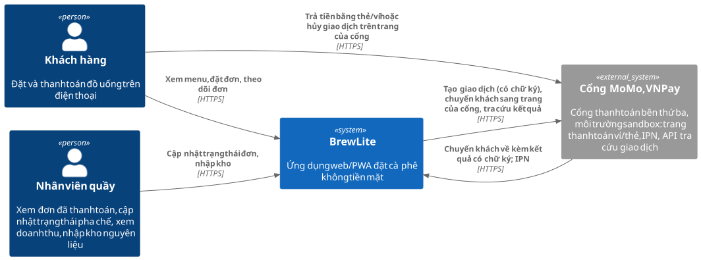
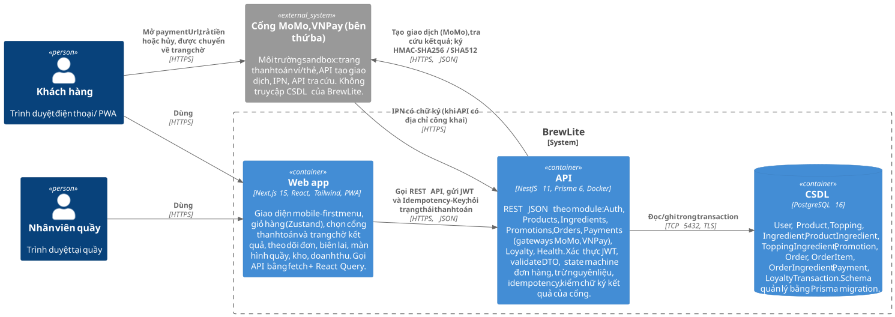
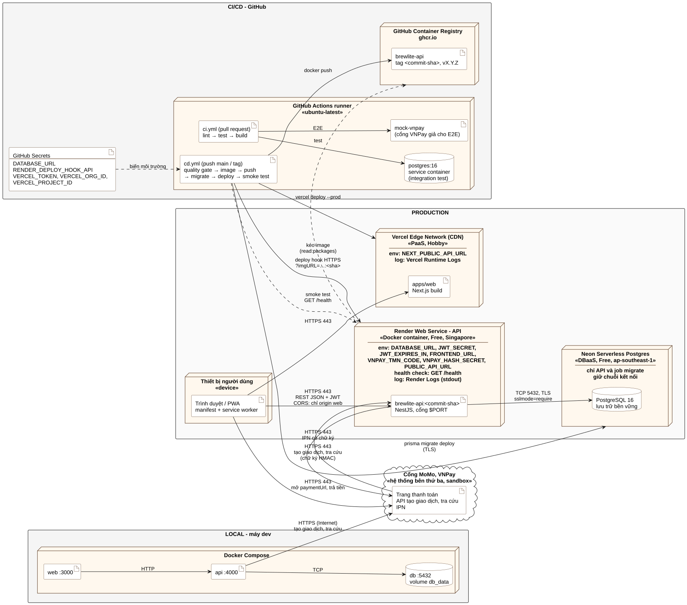
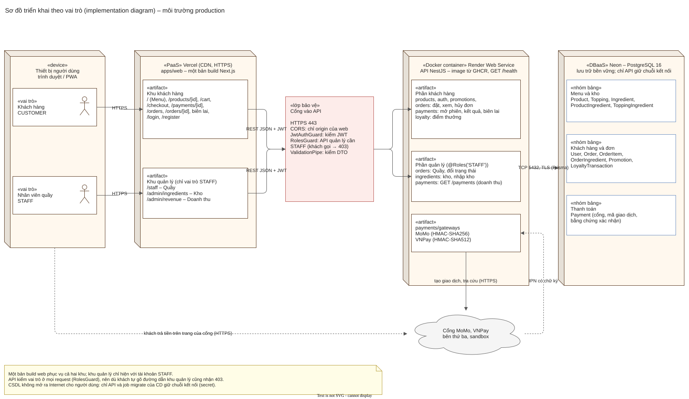

# Kiến trúc BrewLite

Tài liệu Task 3.1. Kiến trúc được trình bày theo mô hình **C4** (mức Context và Container), bên trong mỗi container tổ chức theo **kiến trúc phân lớp**. Các quyết định quan trọng ghi thành ADR trong [adr/](adr/); môi trường production mô tả ở [deployment diagram](#4-triển-khai) và [implementation diagram theo vai trò](#42-triển-khai-theo-vai-trò-người-dùng-implementation-diagram).

## 1. Tổng quan

BrewLite gồm ba khối chính nằm trong một monorepo; thanh toán đi qua cổng bên thứ ba MoMo, VNPay (môi trường sandbox) trên Internet:

| Khối | Công nghệ | Thư mục | Môi trường production |
| --- | --- | --- | --- |
| Web app | Next.js 15 (App Router), React, Tailwind CSS 4, Zustand, React Query, PWA | `apps/web` | Vercel (CDN, HTTPS) |
| API | NestJS 11, Prisma 6, class-validator, Passport JWT | `apps/api` | Render Web Service (Docker) |
| CSDL | PostgreSQL 16, Prisma migration | `apps/api/prisma` | Neon (serverless Postgres) |

### 1.1 Mức Context

Khách hàng và nhân viên quầy dùng BrewLite qua trình duyệt. Khi thanh toán, BrewLite mở giao dịch ở cổng MoMo hoặc VNPay (yêu cầu có chữ ký) và chuyển khách sang trang của cổng; khách trả tiền ở đó, cổng chuyển khách về BrewLite kèm kết quả có chữ ký và gửi IPN. BrewLite kiểm chữ ký, hỏi lại cổng bằng API tra cứu rồi mới đổi trạng thái đơn; BrewLite không tự quyết định một đơn đã được trả tiền (A-03 trong [context-and-scope.md](../requirements/context-and-scope.md), [ADR-010](adr/010-cong-thanh-toan-momo-vnpay.md)).

### 1.2 Mức Container

Tệp nguồn: `c4-context`, `c4-container` (cùng thư mục, cạnh ảnh `.svg`; PlantUML hoặc draw.io).

## 2. Kiến trúc phân lớp

### 2.1 Backend NestJS theo module nghiệp vụ

Mỗi module nghiệp vụ có ba lớp; lớp trên chỉ gọi lớp ngay dưới nó.

| Lớp | Trách nhiệm | Ví dụ |
| --- | --- | --- |
| Controller (giao tiếp) | Nhận HTTP request, gắn guard (JWT, vai trò), validate DTO, đọc header `Idempotency-Key` | `orders.controller.ts`, `orders.dto.ts` |
| Service (nghiệp vụ) | Quy tắc nghiệp vụ, transaction, state machine, tính giá | `orders.service.ts`, `pricing.ts`, `order-state-machine.ts` |
| Truy cập dữ liệu | Prisma Client, transaction, khóa dòng | `PrismaService` (module dùng chung) |

| Module | Nội dung | Yêu cầu |
| --- | --- | --- |
| `auth` | Đăng ký, đăng nhập, `JwtStrategy`, `JwtAuthGuard`, `RolesGuard` | FR-06, FR-07, NFR-03 |
| `products` | Menu và chi tiết món, số ly còn bán được theo size | FR-01, FR-03 |
| `ingredients` | Nguyên liệu, công thức, tính số ly còn bán được (BR-09), trang Kho và nhập kho | FR-02, FR-05, FR-24 |
| `promotions` | Kiểm tra mã giảm giá | FR-09 |
| `orders` | Tạo đơn, trừ và trả nguyên liệu, state machine, hủy đơn, tự hủy, cập nhật trạng thái | FR-08, FR-10, FR-15 – FR-20 |
| `payments` | Mở phiên thanh toán idempotent ở cổng, nhận kết quả có chữ ký (link quay về, IPN, tra cứu), hết hạn phiên; interface `PaymentGateway` với cài đặt `MomoGateway`, `VnpayGateway`; danh sách giao dịch, biên lai | FR-11, FR-12, FR-26 |
| `loyalty` | Ghi giao dịch điểm `EARN`, `REVOKE`, số dư điểm | FR-13, FR-21 |
| `health` | `GET /health`: kiểm tra tiến trình và kết nối CSDL | NFR-07 |
| `common` | Kiểm tra `Idempotency-Key`, middleware ghi log request, cấu hình | FR-10, FR-12, NFR-12 |

### 2.2 Frontend Next.js

| Lớp | Trách nhiệm | Thư mục |
| --- | --- | --- |
| Trang (route) | Mỗi màn hình một route: `/`, `/products/[id]`, `/cart`, `/checkout`, `/payments/[id]` (trang chờ kết quả), `/payments/[id]/receipt` (biên lai), `/login`, `/register`, `/orders`, `/orders/[id]`, `/staff`, `/admin/ingredients` (kho), `/admin/revenue` (doanh thu) | `src/app` |
| Component | Thành phần dùng chung: header, form chọn cổng thanh toán, logo cổng, form đăng nhập, trạng thái tải/trống/lỗi | `src/components` |
| Truy cập API | Hàm `api()` gắn JWT và `Idempotency-Key`, chuẩn hóa lỗi tiếng Việt, tự đăng xuất khi 401; React Query quản lý cache | `src/lib` |
| Trạng thái client | Giỏ hàng và phiên đăng nhập lưu bằng Zustand + localStorage | `src/store` |
| PWA | Web app manifest, icon, service worker | `public/` |

## 3. Các vấn đề xuyên suốt

### 3.1 Dữ liệu và migration

- Schema định nghĩa trong `apps/api/prisma/schema.prisma`; mỗi thay đổi tạo một thư mục migration bằng `prisma migrate dev` và được commit cùng code.
- Local và production chỉ chạy `prisma migrate deploy` (áp các migration chưa chạy, **không** reset dữ liệu). Seed dùng `upsert` nên chạy lại an toàn.
- Migration phải tương thích ngược với phiên bản API đang chạy (chỉ thêm cột/bảng; xóa cột làm ở phiên bản sau) để rollback image không làm hỏng dữ liệu. Chi tiết ở [ADR-003](adr/003-prisma-postgresql-migration.md).

### 3.2 Nhất quán dữ liệu

- Trừ nguyên liệu theo công thức bằng **optimistic locking** (`Ingredient.version`) trong transaction; khóa nguyên liệu theo `ingredientId` tăng dần; lưu lượng đã trừ để hủy đơn trả lại đúng ([ADR-011](adr/011-ton-kho-theo-nguyen-lieu.md)).
- Hủy đơn và thanh toán cùng khóa dòng `Order` bằng `SELECT … FOR UPDATE`.
- Đổi trạng thái đơn chỉ qua `transitionOrder()` với điều kiện `WHERE status = <cũ>`.
- Idempotency cho tạo đơn và thanh toán bằng ràng buộc UNIQUE trên khóa. Xem [ADR-006](adr/006-nhat-quan-ton-kho-va-idempotency.md).

### 3.3 Cổng thanh toán MoMo, VNPay (bên thứ ba, sandbox)

Cổng là hệ thống bên ngoài, không truy cập CSDL của BrewLite. API giao tiếp với cổng qua HTTPS, web chỉ chuyển khách qua lại:

1. `POST /payments` tạo `Payment PROCESSING` (hạn 15 phút, khóa idempotency, `gatewayOrderId` ngẫu nhiên) rồi mở giao dịch ở cổng: VNPay – API tự ký link thanh toán bằng HMAC-SHA512; MoMo – API gọi `/v2/gateway/api/create` có chữ ký HMAC-SHA256. Trả `paymentUrl`; khách không sửa được số tiền.
2. Web chuyển khách sang trang của cổng. Trả xong (hoặc bấm hủy), cổng chuyển khách về `/payments/:id` kèm kết quả có chữ ký; web gửi tham số đó lên `POST /payments/:id/return`.
3. API kiểm chữ ký (so sánh thời gian hằng) và mã giao dịch, hỏi lại cổng bằng API tra cứu, kiểm số tiền rồi mới ghi kết quả. Ở production cổng còn gửi IPN (`POST /payments/momo/ipn`, `GET /payments/vnpay/ipn`); ở máy cá nhân không có IPN nên trang chờ hỏi `GET /payments/:id` và API tự tra cứu cổng (tối đa mỗi 4 giây).
4. Ba đường dùng chung một hàm ghi kết quả, chạy trong transaction có khóa dòng đơn và chỉ xử lý khi `Payment` còn `PROCESSING`, nên kết quả đến nhiều lần chỉ được ghi một lần. Bằng chứng giao dịch (`gatewayRef`, `bankCode`, `payType`, `gatewayResult`) được lưu để in biên lai.

`PaymentsService` chỉ phụ thuộc interface `PaymentGateway` (`createSession`, `parseCallback`, `query`); lời gọi HTTP tách vào `GatewayHttp` để integration test thay bằng cổng giả. Xem [ADR-010](adr/010-cong-thanh-toan-momo-vnpay.md) và [sequence diagram](../diagrams/sequence-checkout.svg).

### 3.4 Logging

- Middleware ghi **một dòng JSON** cho mỗi request: thời điểm, `requestId` (header `X-Request-Id`, tự sinh nếu thiếu), phương thức, đường dẫn, mã trạng thái, thời gian xử lý (ms).
- Không ghi body, header `Authorization`, mật khẩu hay chuỗi kết nối.
- Log in ra stdout; Render và Vercel thu thập và hiển thị trên trang quản trị.

### 3.5 Health check

- `GET /health` trả `200 { status: "ok", db: "ok", version, uptime }` khi truy vấn `SELECT 1` thành công; trả `503` khi không kết nối được CSDL.
- Render dùng `/health` làm health check path; pipeline CD gọi `/health` làm smoke test sau mỗi lần deploy.

### 3.6 Quản lý cấu hình

- Mọi cấu hình đọc từ biến môi trường qua `@nestjs/config`; API kiểm tra các biến bắt buộc (`DATABASE_URL`, `JWT_SECRET`, `FRONTEND_URL`) ngay khi khởi động và dừng nếu thiếu.
- `.env.example` liệt kê đầy đủ biến với giá trị mẫu; file `.env` thật nằm trong `.gitignore`.
- Secret production chỉ nằm ở GitHub Secrets (cho pipeline) và trang cấu hình của Render, Vercel.

| Biến | Dùng ở | Ý nghĩa |
| --- | --- | --- |
| `DATABASE_URL` | API, job migrate | Chuỗi kết nối PostgreSQL (production bắt buộc `sslmode=require`) |
| `JWT_SECRET`, `JWT_EXPIRES_IN` | API | Khóa ký JWT, thời hạn token |
| `FRONTEND_URL` | API | Origin được phép gọi API (CORS), cũng là nơi cổng được phép chuyển khách về |
| `PORT` | API | Cổng lắng nghe (Render tự đặt) |
| `VNPAY_TMN_CODE`, `VNPAY_HASH_SECRET` | API | Mã website và chuỗi bí mật merchant sandbox VNPay (secret, cả nhóm dùng chung) |
| `MOMO_PARTNER_CODE`, `MOMO_ACCESS_KEY`, `MOMO_SECRET_KEY` | API | Khóa MoMo; bỏ trống thì dùng khóa test công khai |
| `PUBLIC_API_URL` | API | Địa chỉ công khai của API, để cổng gọi IPN |
| `NEXT_PUBLIC_API_URL` | Web (lúc build) | URL công khai của API |

## 4. Triển khai

Tệp nguồn: `deployment` (cùng thư mục, cạnh ảnh `.svg`; PlantUML hoặc draw.io). Lý do chọn nền tảng ở [ADR-008](adr/008-nen-tang-trien-khai.md), pipeline ở [ADR-009](adr/009-ci-cd-github-actions.md).

| Môi trường | Thành phần | Ghi chú |
| --- | --- | --- |
| Local | Docker Compose: `web` (3000), `api` (4000), `db` (5432, volume `db_data`); cổng MoMo, VNPay sandbox qua Internet | Một lệnh `docker compose up -d --build`; API tự migrate và seed |
| CI | GitHub Actions: job lint, unit test, integration test (PostgreSQL service container, cổng giả), build; E2E test (cổng VNPay giả) | Chạy khi mở pull request; nhóm chỉ merge khi mọi job thành công |
| CD | GitHub Actions: build image API → push GHCR → migrate Neon → deploy service Render (deploy hook) → deploy Vercel → smoke test `/health`, `/products` | Chạy khi merge vào `main` hoặc tạo tag `v*` |
| Production | Vercel (web), Render (API), Neon (CSDL); cổng MoMo, VNPay sandbox gọi IPN về API | HTTPS ở mọi điểm vào; CSDL chỉ API truy cập |

### 4.1 Truy vết thành phần

Mỗi node của deployment diagram tương ứng một container C4 và một thư mục mã nguồn:

| Node triển khai | Container C4 | Mã nguồn | Cấu hình triển khai |
| --- | --- | --- | --- |
| Vercel Edge Network | Web app | `apps/web` | Project Vercel, biến `NEXT_PUBLIC_API_URL` |
| Render Web Service – API | API | `apps/api`, `apps/api/Dockerfile` | Image `ghcr.io/<owner>/brewlite-api:<sha>` |
| Cổng MoMo, VNPay (Internet) | Hệ thống ngoài | `apps/api/src/payments/gateways` | `VNPAY_*`, `MOMO_*`, IPN URL trên trang merchant |
| Neon Serverless Postgres | CSDL | `apps/api/prisma` | `DATABASE_URL` |
| GitHub Actions, GHCR | (hạ tầng CI/CD) | `.github/workflows/ci.yml`, `cd.yml` | GitHub Secrets |
| Docker Compose (local) | Web app, API, CSDL | `docker-compose.yml` | `.env.example` |

### 4.2 Triển khai theo vai trò người dùng (implementation diagram)

Deployment diagram ở trên chia theo nền tảng. Sơ đồ dưới đây vẽ cùng môi trường production nhưng chia theo **vai trò người dùng**: phần nào của web, API và CSDL phục vụ khách hàng, phần nào phục vụ quản lý (nhân viên quầy). Hệ thống chỉ có hai vai trò `CUSTOMER` và `STAFF` (SRS mục 2); quản lý cửa hàng là stakeholder, không có tài khoản riêng.

Tệp nguồn: [implementation.drawio](implementation.drawio) (draw.io).

| Thành phần trên sơ đồ | Khách hàng | Quản lý (STAFF) | Mã nguồn |
| --- | --- | --- | --- |
| Khu trên web (Vercel) | `/`, `/products/[id]`, `/cart`, `/checkout`, `/payments/[id]`, `/orders`, biên lai, `/login`, `/register` | `/staff` (Quầy), `/admin/ingredients` (Kho), `/admin/revenue` (Doanh thu) | `apps/web/src/app` |
| Cổng vào API | HTTPS, CORS chỉ nhận origin của web, `ValidationPipe`, `JwtAuthGuard` | Thêm `RolesGuard` với `@Roles('STAFF')`: khách gọi trả 403, chưa đăng nhập trả 401 | `apps/api/src/app.setup.ts`, `apps/api/src/auth` |
| Phần của API (Render) | `products`, `auth`, `promotions`, `orders` (đặt, xem, hủy), `payments` (mở phiên, kết quả, biên lai), `loyalty` | `orders` (Quầy, đổi trạng thái), `ingredients` (kho, nhập kho), `payments` (`GET /payments`) | `apps/api/src/<module>` |
| Nhóm bảng (Neon) | Khách hàng và đơn: `User`, `Order`, `OrderItem`, `OrderIngredient`, `Promotion`, `LoyaltyTransaction`; Thanh toán: `Payment` | Menu và kho: `Product`, `Topping`, `Ingredient`, `ProductIngredient`, `ToppingIngredient` (nhập kho) | `apps/api/prisma/schema.prisma` |

Khu quản lý dùng chung một bản build web với khu khách hàng; việc chặn nằm ở API (mọi request đều qua `RolesGuard`), nên khách tự gõ đường dẫn của khu quản lý cũng không đọc được dữ liệu. CSDL không mở cho người dùng: chỉ API và bước migrate của CD giữ chuỗi kết nối.

## 5. Lý do chọn kiến trúc, ưu điểm và hạn chế

| Quyết định | Ưu điểm | Hạn chế / trade-off |
| --- | --- | --- |
| Monorepo một repository cho web, API và tài liệu ([ADR-001](adr/001-monorepo.md)) | Một pull request thay đổi cả API và giao diện; truy vết tài liệu–code dễ; một pipeline | Pipeline phải tách job theo thư mục; repository lớn dần |
| Monolith API theo module thay vì microservice ([ADR-002](adr/002-kien-truc-phan-lop-nestjs.md)) | Đơn giản, transaction trong một CSDL, phù hợp nhóm 6 người và tải nhỏ | Không mở rộng riêng từng phần; một lỗi nặng có thể ảnh hưởng toàn API |
| PostgreSQL + Prisma migration ([ADR-003](adr/003-prisma-postgresql-migration.md)) | Transaction, khóa dòng, ràng buộc UNIQUE cho nghiệp vụ tồn kho nguyên liệu và idempotency; schema có lịch sử | Truy vấn khóa dòng phải viết SQL thô qua Prisma |
| Next.js mobile-first + PWA ([ADR-004](adr/004-frontend-nextjs-pwa.md)) | Một mã nguồn cho điện thoại và máy tính; cài lên màn hình chính không cần app store | Không dùng được tính năng native (thông báo đẩy trên iOS bị hạn chế) |
| JWT không trạng thái ([ADR-005](adr/005-xac-thuc-jwt.md)) | API không cần lưu phiên, dễ chạy trên nền tảng tự khởi động lại | Không thu hồi token trước hạn; giảm rủi ro bằng thời hạn 1 ngày |
| Optimistic locking + idempotency ([ADR-006](adr/006-nhat-quan-ton-kho-va-idempotency.md)) | Không bán quá tồn kho, không trừ tiền hai lần, không cần khóa toàn bảng | Có thể phải thử lại khi xung đột cao; thêm bảng/khóa để quản lý |
| Tồn kho theo nguyên liệu, số ly tính khi đọc ([ADR-011](adr/011-ton-kho-theo-nguyen-lieu.md)) | Đúng cách quán quản lý kho; size lớn tốn nhiều hơn; nhiều món dùng chung nguyên liệu không bán quá | Đọc menu phải tính từ công thức; dòng nguyên liệu dùng chung (ly nhựa) có tranh chấp cao |
| Cổng MoMo, VNPay sandbox, kết quả chỉ nhận khi có chữ ký và tra cứu lại ([ADR-010](adr/010-cong-thanh-toan-momo-vnpay.md), thay [ADR-007](adr/007-cong-thanh-toan-mo-phong.md)) | Bên thứ ba thật xử lý giao dịch; API không tự quyết định đơn đã trả tiền; không phải tự vận hành cổng; có biên lai từ dữ liệu của cổng | Phụ thuộc Internet và độ ổn định của sandbox; khóa VNPay là secret phải bảo vệ; ở máy cá nhân không có IPN, phải tra cứu; chưa có hoàn tiền, đối soát |
| Vercel + Render + Neon ([ADR-008](adr/008-nen-tang-trien-khai.md)) | Miễn phí, HTTPS sẵn, không cần quản trị máy chủ | API ngủ sau 15 phút (đánh thức ~1 phút); Neon có endpoint Internet, không giới hạn IP ở gói miễn phí |
| GitHub Actions + GHCR ([ADR-009](adr/009-ci-cd-github-actions.md)) | Tích hợp sẵn với repository, secret quản lý tập trung, image gắn tag commit để rollback | Phụ thuộc hạn mức phút chạy miễn phí của GitHub |
