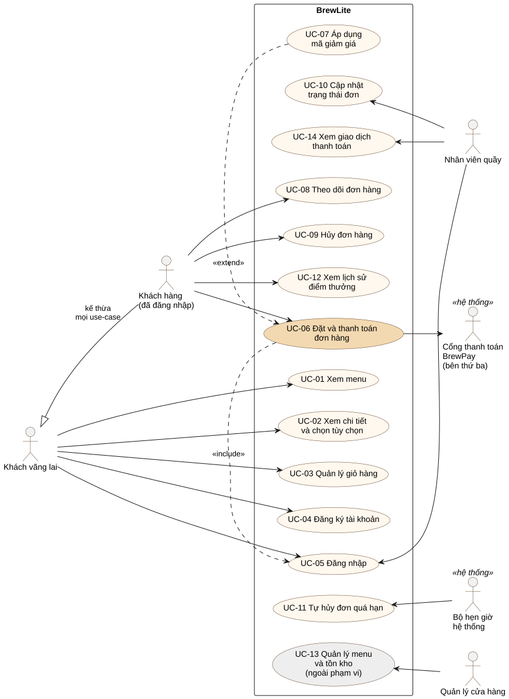

# Đặc tả yêu cầu phần mềm (SRS rút gọn)

Tài liệu Task 1.2 của dự án BrewLite. Bối cảnh, stakeholder và phạm vi xem ở [context-and-scope.md](context-and-scope.md); đặc tả chi tiết use-case trọng tâm ở [uc-06-dat-va-thanh-toan.md](uc-06-dat-va-thanh-toan.md).

## 1. Giới thiệu

### 1.1 Mục đích

Tài liệu mô tả **hệ thống phải làm gì** (yêu cầu chức năng) và **phải đạt chất lượng nào** (yêu cầu phi chức năng). Mỗi yêu cầu có mã định danh, mức ưu tiên MoSCoW và tiêu chí chấp nhận kiểm chứng được. Các task sau dùng mã này để truy vết tới sơ đồ, code và test ([traceability-matrix.md](../traceability-matrix.md)).

### 1.2 Mức ưu tiên MoSCoW

| Mức | Ý nghĩa trong dự án |
| --- | --- |
| **Must** | Bắt buộc có trong bản bàn giao; thiếu thì luồng nghiệp vụ tối thiểu không chạy được |
| **Should** | Quan trọng, làm trong Sprint 2 nếu đủ năng lực; thiếu thì sản phẩm vẫn dùng được |
| **Could** | Có thì tốt; chỉ làm khi đã xong Must và Should |
| **Won't** | Không làm trong phiên bản này; ghi lại cho phiên bản sau |

### 1.3 Thuật ngữ

| Thuật ngữ | Nghĩa |
| --- | --- |
| Khách hàng | Người dùng có vai trò `CUSTOMER` |
| Nhân viên quầy | Người dùng có vai trò `STAFF` (barista) |
| JWT | JSON Web Token, chuỗi xác thực trả về sau khi đăng nhập, gửi kèm header `Authorization: Bearer <token>` |
| Idempotency-Key | Khóa duy nhất do client sinh cho mỗi yêu cầu; gửi lại cùng khóa thì server trả kết quả cũ, không xử lý lần hai |
| Tồn kho | Số phần còn bán được của một món (`stock`) |
| Cổng thanh toán (BrewPay) | Hệ thống bên thứ ba xử lý giao dịch ví/thẻ. Trong dự án là dịch vụ mô phỏng BrewPay chạy riêng, có trang thanh toán và báo kết quả về BrewLite qua webhook |
| Webhook | Yêu cầu HTTP do cổng thanh toán gửi tới API để báo kết quả giao dịch, kèm chữ ký HMAC-SHA256 tính bằng khóa bí mật dùng chung (`GATEWAY_SECRET`) |

### 1.4 Quy tắc nghiệp vụ

Các yêu cầu bên dưới dẫn chiếu tới những quy tắc này.

| Mã | Quy tắc |
| --- | --- |
| BR-01 | Đơn giá một ly = giá size S + phụ thu size (S 0đ, M 5.000đ, L 10.000đ) + tổng giá topping đã chọn. Thành tiền dòng = đơn giá × số lượng. |
| BR-02 | Giá luôn do server tính lại từ CSDL; giá client gửi lên (nếu có) bị bỏ qua. |
| BR-03 | Mỗi dòng trong đơn có số lượng 1–20; mỗi ly tối đa 5 topping; mỗi đơn tối đa 30 dòng. |
| BR-04 | Mã giảm giá áp dụng khi đang hoạt động, chưa hết hạn và tạm tính đạt mức tối thiểu; số tiền giảm = tạm tính × phần trăm giảm, làm tròn xuống. |
| BR-05 | Điểm thưởng: cộng 1 điểm cho mỗi 1.000đ của tổng tiền khi đơn chuyển sang `PAID`; hủy đơn đã `PAID` thì thu hồi đúng số điểm đã cộng. |
| BR-06 | Vòng đời đơn: `PENDING → PAID → PREPARING → READY → COMPLETED`; `PENDING ⇄ PAYMENT_FAILED`; `PENDING`, `PAYMENT_FAILED`, `PAID → CANCELLED`. `COMPLETED` và `CANCELLED` là trạng thái kết thúc. Mọi chuyển tiếp khác bị từ chối. |
| BR-07 | `PAID` và `PAYMENT_FAILED` chỉ do webhook có chữ ký hợp lệ của cổng thanh toán đặt; web và nhân viên không đặt được hai trạng thái này. Nhân viên chỉ được đặt `PREPARING`, `READY`, `COMPLETED`, `CANCELLED`. |
| BR-08 | Đơn ở `PENDING` hoặc `PAYMENT_FAILED` quá 15 phút kể từ lần cập nhật cuối thì tự hủy và trả hàng về kho. |

## 2. Mô tả tổng quan

### 2.1 Tác nhân

| Tác nhân | Mô tả |
| --- | --- |
| Khách vãng lai | Chưa đăng nhập; xem menu, chi tiết, quản lý giỏ hàng, đăng ký, đăng nhập |
| Khách hàng | Đã đăng nhập; thêm các chức năng đặt đơn, thanh toán, theo dõi và hủy đơn |
| Nhân viên quầy | Đăng nhập vai trò `STAFF`; xem đơn cần pha và cập nhật trạng thái |
| Quản lý cửa hàng | Quản lý menu và tồn kho (ngoài phạm vi phiên bản này) |
| Cổng thanh toán BrewPay | Hệ thống bên thứ ba (mô phỏng): khách xác nhận thanh toán trên trang của cổng, cổng báo kết quả về BrewLite |
| Bộ hẹn giờ hệ thống | Kích hoạt việc tự hủy đơn chưa thanh toán quá hạn |

### 2.2 Môi trường vận hành

- Frontend Next.js chạy trên trình duyệt điện thoại và máy tính; cài được dưới dạng PWA.
- Backend NestJS cung cấp REST API JSON; dữ liệu lưu trong PostgreSQL.
- Cổng thanh toán BrewPay là dịch vụ riêng, chỉ trao đổi với API qua HTTP (link có chữ ký và webhook).
- Ba môi trường: **local** (Docker Compose), **CI** (GitHub Actions), **production** (Vercel cho web, Render cho API và BrewPay, Neon cho PostgreSQL). Chi tiết ở tài liệu kiến trúc.

## 3. Yêu cầu chức năng

### 3.1 Menu và chi tiết sản phẩm

| Mã | Yêu cầu | Ưu tiên | Tiêu chí chấp nhận |
| --- | --- | --- | --- |
| FR-01 | Hiển thị menu đồ uống lấy từ CSDL | Must | 1. `GET /products` trả về danh sách gồm `id`, `name`, `description`, `price`, `imageUrl`, `stock`, sắp theo `id` tăng dần, không cần đăng nhập. 2. Trang Menu hiển thị lưới sản phẩm (ảnh, tên, giá VNĐ). 3. Khi đang tải hiển thị khung chờ; danh sách rỗng hiển thị "Menu đang được cập nhật"; lỗi kết nối hiển thị thông báo và nút **Thử lại**. |
| FR-02 | Hiển thị tình trạng hàng | Should | 1. Món có `stock = 0` hiển thị nhãn "Hết hàng" và không thêm được vào giỏ. 2. Món có `1 ≤ stock ≤ 5` hiển thị "Còn N". |
| FR-03 | Xem chi tiết và chọn tùy chọn | Must | 1. `GET /products/:id` trả về thông tin món kèm danh sách size (S, M, L và phụ thu) và topping; `id` không phải số trả 400, không tồn tại trả 404. 2. Trang chi tiết cho chọn size, topping (nhiều lựa chọn) và số lượng. 3. Thành tiền cập nhật ngay khi đổi lựa chọn, đúng BR-01. |

### 3.2 Giỏ hàng

| Mã | Yêu cầu | Ưu tiên | Tiêu chí chấp nhận |
| --- | --- | --- | --- |
| FR-04 | Quản lý giỏ hàng | Must | 1. Thêm món vào giỏ; cùng món, cùng size, cùng bộ topping thì gộp thành một dòng. 2. Sửa số lượng (tối thiểu 1), xóa dòng; tổng tiền và số lượng trên header cập nhật ngay. 3. Tải lại trang hoặc đóng mở trình duyệt thì giỏ vẫn còn. 4. Giỏ trống hiển thị thông báo và đường dẫn về Menu. |
| FR-05 | Giới hạn số lượng theo tồn kho | Should | 1. Ở trang chi tiết, số lượng chọn tối đa = tồn kho − số ly món đó đã có trong giỏ (cộng mọi size, topping) và không quá 20. 2. Ở giỏ hàng, không tăng được quá tồn kho; nếu giỏ đang vượt tồn kho thì báo lỗi trên dòng đó và khóa nút thanh toán. 3. Trang Menu hiển thị số ly mỗi món đang có trong giỏ. |

### 3.3 Xác thực

| Mã | Yêu cầu | Ưu tiên | Tiêu chí chấp nhận |
| --- | --- | --- | --- |
| FR-06 | Đăng ký tài khoản | Must | 1. `POST /auth/register` nhận email, mật khẩu (6–72 ký tự), họ tên (2–100 ký tự); dữ liệu sai trả 400 kèm thông báo tiếng Việt. 2. Email trùng (không phân biệt hoa thường) trả 409. 3. Thành công trả JWT và thông tin người dùng (không có mật khẩu); mật khẩu lưu dạng băm bcrypt. |
| FR-07 | Đăng nhập và duy trì phiên | Must | 1. `POST /auth/login` đúng thông tin trả JWT; sai email hoặc mật khẩu đều trả 401 với cùng một thông báo. 2. Các API đặt đơn, thanh toán, xem đơn trả 401 khi thiếu hoặc sai token. 3. Vào trang thanh toán khi chưa đăng nhập thì chuyển tới trang đăng nhập, đăng nhập xong quay lại đúng trang thanh toán. 4. Token hết hạn (sau 1 ngày) thì giao diện tự đăng xuất và yêu cầu đăng nhập lại. |

### 3.4 Đặt đơn

| Mã | Yêu cầu | Ưu tiên | Tiêu chí chấp nhận |
| --- | --- | --- | --- |
| FR-08 | Tạo đơn hàng | Must | 1. `POST /orders` (cần JWT) nhận danh sách `productId`, `size`, `toppingIds`, `qty` và mã giảm giá tùy chọn; dữ liệu vi phạm BR-03 trả 400. 2. Server tính giá theo BR-01, BR-02; món hoặc topping không tồn tại trả 400. 3. Trừ tồn kho và tạo đơn trong cùng một transaction; món không đủ hàng trả 409 "… chỉ còn N phần" và không tạo đơn, không trừ kho món nào. 4. Đơn mới ở trạng thái `PENDING`; phản hồi có mã đơn, các dòng, tạm tính, giảm giá, tổng tiền. |
| FR-09 | Áp dụng mã giảm giá | Should | 1. `GET /promotions/:code?subtotal=` cho biết mã có hợp lệ với tạm tính hiện tại không, kèm số tiền giảm hoặc lý do từ chối. 2. Mã không tồn tại, đã ngừng, hết hạn hoặc chưa đạt mức tối thiểu bị từ chối với lý do tương ứng (BR-04). 3. Khi tạo đơn, server kiểm tra lại mã; mã không hợp lệ trả 400. |
| FR-10 | Chống tạo đơn trùng | Should | 1. `POST /orders` nhận header `Idempotency-Key` tùy chọn (8–100 ký tự chữ, số, `-`, `_`); sai định dạng trả 400. 2. Cùng người dùng gửi lại cùng khóa thì nhận lại đơn đã tạo, không tạo đơn mới, không trừ kho lần hai, kể cả khi hai yêu cầu đến đồng thời. |

### 3.5 Thanh toán

| Mã | Yêu cầu | Ưu tiên | Tiêu chí chấp nhận |
| --- | --- | --- | --- |
| FR-11 | Thanh toán bằng Ví hoặc Thẻ qua cổng bên thứ ba BrewPay (mô phỏng) | Must | 1. `POST /payments` (cần JWT) nhận `orderId`, `method` (`WALLET` hoặc `CARD`); chỉ thanh toán được đơn của chính mình ở `PENDING` hoặc `PAYMENT_FAILED`. API tạo phiên thanh toán `PROCESSING` hạn 15 phút và trả `paymentUrl` sang BrewPay (link có chữ ký); đơn vẫn `PENDING`. 2. Web hiển thị mã QR chứa `paymentUrl` và nút mở BrewPay trên cùng thiết bị; web hỏi `GET /payments/:id` mỗi 1,5 giây và tự chuyển trang khi có kết quả. 3. Chỉ webhook `POST /payments/webhook` có chữ ký hợp lệ của BrewPay mới đổi kết quả: `SUCCESS` → bản ghi thanh toán `SUCCESS`, đơn `PAID`; `FAILED` → bản ghi `FAILED`, đơn `PAYMENT_FAILED`, giao diện báo lỗi và **giữ nguyên giỏ hàng**. 4. Webhook sai chữ ký trả 401, số tiền khác số tiền của phiên trả 400; cả hai trường hợp không đổi trạng thái. 5. Phiên quá 15 phút chưa có kết quả được đánh `FAILED`. Đơn `PAYMENT_FAILED` thanh toán lại được; không tạo đơn mới. |
| FR-12 | Thanh toán idempotent | Must | 1. `POST /payments` bắt buộc header `Idempotency-Key`; thiếu hoặc sai định dạng trả 400. 2. Gửi lại cùng khóa trả lại đúng phiên của lần đầu (`replayed: true`), không tạo phiên mới, không cộng điểm lần hai. 3. Hai yêu cầu cùng khóa đến đồng thời chỉ tạo đúng một bản ghi thanh toán. 4. Dùng lại một khóa cho đơn khác trả 409; đơn đang có phiên còn hạn thì yêu cầu với khóa khác nhận lại phiên đó. 5. Cùng một webhook gửi nhiều lần chỉ được xử lý một lần: thanh toán không còn `PROCESSING` thì trả 200 và bỏ qua. |
| FR-13 | Điểm thưởng | Should | 1. Đơn sang `PAID` thì cộng điểm theo BR-05 và ghi một giao dịch điểm loại `EARN` gắn với đơn. 2. Hủy đơn đã `PAID` thì ghi giao dịch `REVOKE` với số điểm âm tương ứng. 3. Số dư điểm của người dùng luôn bằng tổng các giao dịch điểm; mỗi đơn có tối đa một `EARN` và một `REVOKE`. |

### 3.6 Theo dõi đơn

| Mã | Yêu cầu | Ưu tiên | Tiêu chí chấp nhận |
| --- | --- | --- | --- |
| FR-14 | Xác nhận đơn | Must | 1. Sau khi thanh toán thành công, giao diện chuyển tới màn hình xác nhận và xóa giỏ hàng. 2. Màn hình có mã đơn, trạng thái, danh sách món, giảm giá, tổng tiền, số điểm vừa cộng và lời nhắc tới quầy nhận nước. |
| FR-15 | Lịch sử và chi tiết đơn | Must | 1. `GET /orders/me` trả các đơn của chính người dùng, mới nhất trước. 2. `GET /orders/:id` trả chi tiết đơn của chính người dùng; đơn của người khác hoặc không tồn tại trả 404. 3. Trang Lịch sử hiển thị mã, thời gian, tóm tắt món, tổng tiền, trạng thái; bấm vào để xem chi tiết. |
| FR-16 | Hủy đơn | Should | 1. Khách hủy được đơn của mình khi đơn ở `PENDING`, `PAYMENT_FAILED` hoặc `PAID`; trạng thái khác trả 409. 2. Hủy thì trả số lượng về tồn kho và thu hồi điểm theo BR-05. 3. Đơn đang có phiên thanh toán còn hạn (chờ BrewPay báo kết quả) thì không hủy được (409). |

### 3.7 Quản lý trạng thái đơn

| Mã | Yêu cầu | Ưu tiên | Tiêu chí chấp nhận |
| --- | --- | --- | --- |
| FR-17 | Vòng đời trạng thái đơn | Must | 1. Mọi thay đổi trạng thái đi qua một hàm kiểm tra theo BR-06; chuyển tiếp không hợp lệ trả 409. 2. Hai yêu cầu đổi trạng thái cùng lúc trên một đơn chỉ một yêu cầu thành công. |
| FR-18 | Nhân viên cập nhật trạng thái | Must | 1. `PATCH /orders/:id/status` chỉ cho vai trò `STAFF`; khách gọi trả 403. 2. Chỉ nhận các giá trị theo BR-07; giá trị khác trả 400. |
| FR-19 | Màn hình quầy | Should | 1. Nhân viên đăng nhập thấy đơn chia 5 nhóm, mỗi nhóm có số đơn: chờ pha (`PAID`), đang pha (`PREPARING`), sẵn sàng (`READY`), đã giao (`COMPLETED`), đã hủy (`CANCELLED`); ba nhóm đầu xếp cũ nhất trước, hai nhóm sau mới nhất trước; mỗi đơn kèm món, size, topping. 2. Mỗi đơn chưa xong có nút chuyển sang trạng thái kế tiếp; đơn `PAID` có thêm nút hủy (hỏi xác nhận trước khi hủy); danh sách tự làm mới tối thiểu mỗi 15 giây. |
| FR-20 | Tự hủy đơn chưa thanh toán | Should | 1. Đơn thỏa BR-08 được hủy tự động, trả hàng về kho. 2. Việc kiểm tra chạy định kỳ và mỗi khi có đơn mới, để hàng không bị giữ khi server vừa khởi động lại. |

### 3.8 Mở rộng và ngoài phạm vi

| Mã | Yêu cầu | Ưu tiên | Ghi chú |
| --- | --- | --- | --- |
| FR-21 | Xem lịch sử điểm thưởng | Could | Liệt kê các giao dịch `EARN`, `REVOKE` của người dùng |
| FR-22 | Thông báo khi đơn sẵn sàng | Could | Thông báo trong ứng dụng khi đơn chuyển sang `READY` |
| FR-23 | Đổi điểm thưởng lấy giảm giá | Won't | Phiên bản sau |
| FR-24 | Quản lý menu, giá, tồn kho | Won't | Phiên bản sau; hiện nạp bằng seed |
| FR-25 | Thanh toán qua cổng thật, hoàn tiền tự động | Won't | Cần hợp đồng merchant; nhân viên hoàn tiền tại quầy dựa trên mục "Cần hoàn tiền" của FR-26 |
| FR-26 | Xem giao dịch thanh toán | Could | `GET /payments` chỉ cho vai trò `STAFF`: 100 giao dịch mới nhất, lọc theo trạng thái (thành công, cần hoàn tiền, đang chờ, thất bại, hết hạn); tổng tiền đã nhận chỉ tính giao dịch `SUCCESS` của đơn chưa hủy; giao dịch `SUCCESS` của đơn đã hủy hiện là "Cần hoàn tiền" và có tổng riêng; trang tự làm mới để thấy tiền vào khi BrewPay báo về |

## 4. Yêu cầu phi chức năng

| Mã | Nhóm | Yêu cầu | Ưu tiên | Tiêu chí chấp nhận |
| --- | --- | --- | --- | --- |
| NFR-01 | Hiệu năng | API đọc menu phản hồi nhanh | Must | `GET /products` và `GET /products/:id` có p95 ≤ 500 ms với dữ liệu seed khi server đã khởi động (không tính lần đánh thức đầu tiên trên gói miễn phí). |
| NFR-02 | Hiệu năng | Giao dịch đặt và thanh toán | Should | Chuỗi `POST /orders` + `POST /payments` (tới lúc có `paymentUrl`) hoàn tất trong ≤ 1 giây (p95) ở môi trường local và CI; `POST /payments/webhook` xử lý trong ≤ 500 ms. Không tính thời gian khách thao tác trên trang BrewPay. |
| NFR-03 | Bảo mật | Xác thực và mật khẩu | Must | Mật khẩu băm bcrypt (cost 10); JWT ký bằng secret lấy từ biến môi trường, hết hạn sau 1 ngày; không API nào trả `passwordHash`. |
| NFR-04 | Bảo mật | Kiểm soát dữ liệu và quyền | Must | DTO validate theo whitelist (trường lạ trả 400); giá do server tính; khách không đọc được đơn của người khác; chỉ `STAFF` đổi trạng thái pha chế và xem danh sách giao dịch; kết quả thanh toán chỉ được nhận từ webhook có chữ ký HMAC-SHA256 hợp lệ (so sánh thời gian hằng), link sang cổng thanh toán được ký để khách không sửa được số tiền. |
| NFR-05 | Bảo mật | An toàn khi triển khai | Must | Web, API và BrewPay chỉ phục vụ qua HTTPS; `JWT_SECRET`, `GATEWAY_SECRET` và chuỗi kết nối CSDL là secret; CORS chỉ cho origin của frontend; secret chỉ nằm trong GitHub Secrets và biến môi trường của nền tảng, không có trong repository hay log CI; chỉ API được giữ chuỗi kết nối CSDL, kết nối bắt buộc TLS. |
| NFR-06 | Toàn vẹn dữ liệu | Xử lý đồng thời | Must | 10 yêu cầu đặt đồng thời món còn 3 phần: đúng 3 đơn thành công, tồn kho về 0, không âm; không có trạng thái đơn ngoài sơ đồ BR-06. |
| NFR-07 | Tính khả dụng | Health check và phục hồi | Must | `GET /health` trả 200 khi API và CSDL hoạt động, 503 khi không kết nối được CSDL; BrewPay cũng có `GET /health`; nền tảng dùng các endpoint này để kiểm tra; URL production truy cập được tại thời điểm nghiệm thu (chấp nhận thời gian đánh thức ≤ 60 giây của gói miễn phí). |
| NFR-08 | Tính dễ dùng | Mobile-first | Must | Mọi trang dùng được ở chiều rộng 375 px không cuộn ngang; nút bấm đủ lớn cho ngón tay; thông báo lỗi bằng tiếng Việt; trang dữ liệu có trạng thái đang tải, trống và lỗi. |
| NFR-09 | Tính dễ dùng | PWA | Should | Có web app manifest và icon; trình duyệt điện thoại cho "Thêm vào màn hình chính"; khi mất mạng hiển thị trang thông báo thay vì lỗi trình duyệt. |
| NFR-10 | Khả năng triển khai | Tái tạo và tự động hóa | Must | Local chạy đủ web, API, BrewPay, CSDL bằng một lệnh `docker compose up`; migration và seed tái tạo được CSDL; pipeline tự động lint → test → build → image → deploy → smoke test; rollback về phiên bản trước trong ≤ 10 phút theo hướng dẫn. |
| NFR-11 | Khả năng bảo trì | Chất lượng mã | Must | Lint, unit test, integration test, E2E test chạy trong CI trên mọi pull request; pull request chỉ được merge khi mọi job CI thành công và có ít nhất một approve; commit theo Conventional Commits. |
| NFR-12 | Vận hành | Ghi log | Should | Mỗi request ghi một dòng log gồm phương thức, đường dẫn, mã trạng thái, thời gian xử lý và request id; không ghi mật khẩu, token, chuỗi kết nối. |
| NFR-13 | Tương thích | Trình duyệt | Should | Chạy đúng trên Chrome, Edge, Firefox bản mới và Safari iOS 16 trở lên. |

## 5. Sơ đồ use-case tổng quát

Tệp nguồn: `use-case-overview` (cùng thư mục, cạnh ảnh `.svg`; PlantUML hoặc draw.io).

| Use-case | Tác nhân chính | Yêu cầu |
| --- | --- | --- |
| UC-01 Xem menu | Khách vãng lai, Khách hàng | FR-01, FR-02 |
| UC-02 Xem chi tiết và chọn tùy chọn | Khách vãng lai, Khách hàng | FR-03, FR-05 |
| UC-03 Quản lý giỏ hàng | Khách vãng lai, Khách hàng | FR-04, FR-05 |
| UC-04 Đăng ký tài khoản | Khách vãng lai | FR-06 |
| UC-05 Đăng nhập | Khách vãng lai, Nhân viên quầy | FR-07 |
| **UC-06 Đặt và thanh toán đơn hàng** | Khách hàng; Cổng thanh toán BrewPay | FR-08, FR-10, FR-11, FR-12, FR-13, FR-14 |
| UC-07 Áp dụng mã giảm giá | Khách hàng | FR-09 |
| UC-08 Theo dõi đơn hàng | Khách hàng | FR-14, FR-15, FR-22 |
| UC-09 Hủy đơn hàng | Khách hàng | FR-16, FR-13 |
| UC-10 Cập nhật trạng thái đơn | Nhân viên quầy | FR-17, FR-18, FR-19 |
| UC-11 Tự hủy đơn quá hạn | Bộ hẹn giờ hệ thống | FR-20 |
| UC-12 Xem lịch sử điểm thưởng | Khách hàng | FR-21 |
| UC-13 Quản lý menu và tồn kho | Quản lý cửa hàng | FR-24 (ngoài phạm vi) |
| UC-14 Xem giao dịch thanh toán | Nhân viên quầy | FR-26 |

## 6. Quy ước mã kiểm thử

Các task sau đặt mã test theo quy ước dưới đây và ghi vào ma trận truy vết.

| Tiền tố | Loại kiểm thử | Vị trí dự kiến |
| --- | --- | --- |
| `UT-xx` | Unit test nghiệp vụ (tính giá, state machine, mã giảm giá, điểm thưởng) | `apps/api/src/**/*.spec.ts` |
| `CT-xx` | Test component giao diện | `apps/web/src/**/*.test.tsx` |
| `API-Txx` | Integration test API trên PostgreSQL thật | `tests/integration/` |
| `E2E-Txx` | End-to-end test trên trình duyệt, từ Menu tới xác nhận đơn | `tests/e2e/` |
| `SMK-xx` | Smoke test sau khi deploy production | pipeline CD |
