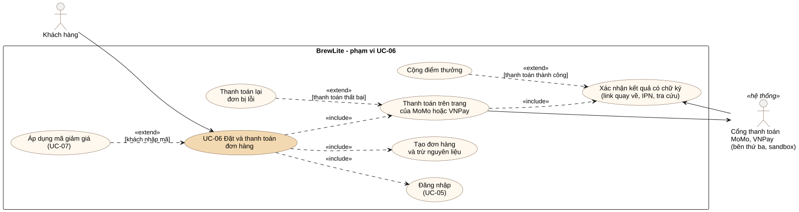

# UC-06 – Đặt và thanh toán đơn hàng

Tài liệu Task 1.3: đặc tả use-case trọng tâm của BrewLite. Đây là use-case mang giá trị nghiệp vụ chính: khách tự đặt và trả tiền không tiền mặt, không phải xếp hàng tại quầy.

Tệp nguồn: `uc-06-dat-va-thanh-toan` (cùng thư mục, cạnh ảnh `.svg`; PlantUML hoặc draw.io).

## 1. Thông tin chung

| Mục | Nội dung |
| --- | --- |
| Mã, tên | UC-06 Đặt và thanh toán đơn hàng |
| Tác nhân chính | Khách hàng |
| Tác nhân phụ | Cổng thanh toán MoMo, VNPay (hệ thống bên thứ ba, môi trường sandbox) |
| Mục tiêu | Khách tạo đơn từ giỏ hàng và trả tiền qua cổng MoMo hoặc VNPay, nhận mã đơn để tới quầy lấy nước |
| Trigger | Khách bấm **Thanh toán** ở trang Giỏ hàng |
| Mức ưu tiên | Must |
| Yêu cầu liên quan | FR-07, FR-08, FR-09, FR-10, FR-11, FR-12, FR-13, FR-14, FR-17; NFR-02, NFR-04, NFR-06; quy tắc BR-01 – BR-07, BR-09 |
| Use-case liên quan | «include» UC-05 Đăng nhập; «extend» UC-07 Áp dụng mã giảm giá; dẫn tới UC-08 Theo dõi đơn hàng |

## 2. Điều kiện

**Tiền điều kiện**

1. Giỏ hàng có ít nhất một dòng, số lượng mỗi dòng 1–20.
2. API, CSDL đang hoạt động; máy chủ và trình duyệt của khách kết nối được tới cổng MoMo, VNPay trên Internet.

**Hậu điều kiện khi thành công**

1. Có một đơn mới của khách ở trạng thái `PAID`, giá do server tính.
2. Nguyên liệu của các món trong đơn đã giảm đúng theo công thức và size (BR-09); lượng đã trừ được lưu theo đơn.
3. Có một bản ghi thanh toán `SUCCESS` gắn với `Idempotency-Key` của yêu cầu, ghi cổng đã dùng, mã giao dịch của cổng, ngân hàng và dữ liệu gốc cổng gửi về.
4. Điểm thưởng của khách tăng theo BR-05 và có giao dịch điểm `EARN` gắn với đơn.
5. Giỏ hàng trống; khách đang ở màn hình xác nhận đơn và mở được biên lai thanh toán.

**Hậu điều kiện khi thất bại**

- Thất bại trước khi tạo đơn (dữ liệu sai, thiếu nguyên liệu, mất kết nối): không có đơn mới, nguyên liệu không đổi, giỏ hàng giữ nguyên.
- Thanh toán thất bại (khách bấm hủy trên trang cổng, cổng từ chối, phiên hết hạn): đơn ở `PAYMENT_FAILED` hoặc vẫn `PENDING`, nguyên liệu vẫn được giữ cho đơn; bản ghi thanh toán `FAILED`; giỏ hàng giữ nguyên; không cộng điểm. Nếu khách không thanh toán lại trong 15 phút, đơn tự hủy và trả nguyên liệu về kho (UC-11).

## 3. Luồng chính

| Bước | Tác nhân | Hành động |
| --- | --- | --- |
| 1 | Khách hàng | Bấm **Thanh toán** ở trang Giỏ hàng. |
| 2 | Hệ thống (web) | Kiểm tra đã đăng nhập (có JWT), mở trang Thanh toán với danh sách món, tạm tính, tổng tiền và hai lựa chọn cổng MoMo, VNPay. |
| 3 | Khách hàng | Chọn cổng **MoMo** hoặc **VNPay**, bấm **Thanh toán … qua MoMo/VNPay**. |
| 4 | Hệ thống (web) | Gửi `POST /orders` kèm JWT, danh sách món và `Idempotency-Key` của giỏ hàng hiện tại. |
| 5 | Hệ thống (API) | Kiểm tra JWT; validate dữ liệu (BR-03); tính lại giá từ CSDL (BR-01, BR-02); kiểm tra mã giảm giá nếu có. |
| 6 | Hệ thống (API) | Tính nguyên liệu cần cho cả đơn theo công thức và size (BR-09). Trong một transaction: trừ từng nguyên liệu theo `ingredientId` tăng dần bằng optimistic locking, tạo đơn `PENDING` và lưu lượng nguyên liệu đã trừ. Trả về đơn kèm mã đơn. |
| 7 | Hệ thống (web) | Sinh `Idempotency-Key` mới cho lần thanh toán, gửi `POST /payments` với mã đơn, cổng đã chọn và địa chỉ web đang mở. |
| 8 | Hệ thống (API) | Khóa dòng đơn hàng; kiểm tra đơn thuộc về khách và còn thanh toán được; tạo bản ghi thanh toán `PROCESSING` (hạn 15 phút) với khóa UNIQUE và mã giao dịch gửi cổng. Mở giao dịch ở cổng: VNPay – ký link thanh toán bằng HMAC-SHA512; MoMo – gọi API tạo giao dịch có chữ ký HMAC-SHA256. Trả `paymentUrl` sang trang của cổng; đơn vẫn `PENDING`. |
| 9 | Hệ thống (web) | Chuyển trình duyệt sang `paymentUrl` (trang thanh toán của cổng). |
| 10 | Khách hàng | Xem số tiền trên trang của cổng, nhập thẻ (hoặc quét mã bằng app) và xác nhận trả tiền. |
| 11 | Cổng thanh toán | Trừ tiền, chuyển khách về trang chờ `/payments/:id` của BrewLite kèm kết quả có chữ ký; khi API có địa chỉ công khai, cổng gửi thêm IPN tới API. |
| 12 | Hệ thống (web) | Gửi tham số cổng gắn vào link quay về lên `POST /payments/:id/return`. |
| 13 | Hệ thống (API) | Kiểm tra chữ ký và mã giao dịch; hỏi lại cổng bằng API tra cứu; với kết quả thành công và số tiền khớp: trong một transaction, thanh toán `SUCCESS` (lưu mã giao dịch, ngân hàng, dữ liệu gốc), đơn `PENDING → PAID`, cộng điểm và ghi giao dịch điểm `EARN`. |
| 14 | Hệ thống (web) | Nhận đơn `PAID`: xóa giỏ hàng, cập nhật số điểm trên header, chuyển tới màn hình xác nhận. |
| 15 | Khách hàng | Thấy mã đơn, trạng thái `PAID`, các món, tổng tiền, số điểm vừa cộng, lời nhắc tới quầy nhận nước và nút xem biên lai. Use-case kết thúc. |

## 4. Luồng thay thế

| Mã | Tại bước | Điều kiện | Xử lý |
| --- | --- | --- | --- |
| A1 | 2 | Khách chưa đăng nhập | Web chuyển tới trang Đăng nhập kèm đường dẫn quay lại (UC-05). Đăng nhập thành công thì quay lại bước 2 với giỏ hàng giữ nguyên. |
| A2 | 3 | Khách nhập mã giảm giá (UC-07) | Web gọi `GET /promotions/:code?subtotal=`. Mã hợp lệ: hiển thị dòng giảm giá và tổng mới, gửi kèm mã ở bước 4. Mã không hợp lệ: hiển thị lý do (hết hạn, chưa đạt tối thiểu…), khách tiếp tục không dùng mã. |
| A3 | 4–6 | Web gửi lại `POST /orders` với cùng khóa (mạng chậm, bấm lại sau lỗi) | API thấy khóa `userId:key` đã có đơn, trả lại đơn cũ; không tạo đơn mới, không trừ nguyên liệu lần hai. Tiếp tục bước 7. |
| A4 | 7–8 | Web gửi lại `POST /payments` với cùng `Idempotency-Key`, hoặc đơn đã có phiên còn hạn ở cùng cổng | API trả lại đúng phiên đó với `replayed: true`; không mở giao dịch mới ở cổng, không cộng điểm lần hai. |
| A5 | 15 | Khách thanh toán lại một đơn `PAYMENT_FAILED` hoặc có phiên đã hết hạn | Trang chờ (hoặc màn hình đơn hàng) cho chọn lại cổng; thực hiện lại từ bước 7 với khóa thanh toán mới; đơn `PAYMENT_FAILED → PENDING` khi phiên mới được mở. |
| A6 | 11–13 | Kết quả đến nhiều lần: link quay về, IPN và tra cứu cùng báo, hoặc cổng gửi lặp IPN | Chỉ lần đầu được xử lý; các lần sau thấy thanh toán không còn `PROCESSING` thì bỏ qua (IPN VNPay nhận mã "đã xác nhận"); không cộng điểm lần hai. |
| A7 | 10–12 | Khách trả bằng app trên điện thoại khác và không quay về trang chờ trên máy đang dùng | Trang chờ hỏi `GET /payments/:id` mỗi 1,5 giây; API tự tra cứu cổng (tối đa mỗi 4 giây) và ghi kết quả như bước 13; trang tự chuyển tới màn hình xác nhận. |
| A8 | 11–13 | Phiên đã hết hạn ở BrewLite nhưng cổng vẫn báo đã trừ tiền | API vẫn ghi thanh toán `SUCCESS`; đơn còn chờ thì sang `PAID`, đơn đã hủy thì giao dịch vào mục "Cần hoàn tiền" (FR-26). |

## 5. Luồng ngoại lệ

| Mã | Tại bước | Điều kiện | Xử lý và kết quả |
| --- | --- | --- | --- |
| E1 | 5 | Dữ liệu không hợp lệ (số lượng ngoài 1–20, size sai, món không tồn tại, trường lạ) | API trả 400 kèm thông báo tiếng Việt; web hiển thị lỗi, giỏ giữ nguyên. Use-case kết thúc thất bại. |
| E2 | 5, 8 | JWT thiếu, sai hoặc hết hạn | API trả 401; web đăng xuất và chuyển tới trang Đăng nhập (tiếp tục như A1). |
| E3 | 6 | Không đủ nguyên liệu cho một dòng | Transaction bị hủy toàn bộ, không trừ nguyên liệu nào; API trả 409 "‹tên món› size ‹S/M/L› chỉ còn N ly" (hoặc nêu tên nguyên liệu khi nhiều món dùng chung); web hiển thị lỗi, khách sửa giỏ hàng. Use-case kết thúc thất bại. |
| E4 | 6 | Nhiều khách tranh cùng nguyên liệu, cập nhật tồn kho bị xung đột quá số lần thử | API trả 409 "Có nhiều người đặt cùng lúc, vui lòng thử lại"; không tạo đơn. |
| E5 | 10–13 | Khách bấm **Hủy** trên trang cổng, hoặc cổng từ chối giao dịch | Cổng chuyển khách về kèm kết quả thất bại có chữ ký; API ghi thanh toán `FAILED`, đơn `PENDING → PAYMENT_FAILED`, không cộng điểm; trang chờ báo "Thanh toán không thành công", **giữ nguyên giỏ hàng**, cho khách chọn cổng thanh toán lại (A5). |
| E6 | 8 | Cổng không mở được giao dịch (mất kết nối, cổng từ chối) | API đánh bản ghi thanh toán `FAILED`, trả 502 kèm lý do; đơn vẫn `PENDING`; khách bấm thanh toán lại hoặc chọn cổng kia. |
| E7 | 8 | Dùng lại một `Idempotency-Key` cho đơn khác, hoặc chọn cổng khác khi đơn còn phiên mở ở cổng cũ | API trả 409; web hiển thị thông báo (tiếp tục trên cổng cũ hoặc hủy giao dịch ở đó rồi chọn lại). |
| E8 | 4–9 | Không kết nối được máy chủ | Web hiển thị "Không kết nối được máy chủ"; giỏ hàng giữ nguyên; khách thử lại (dùng lại khóa theo A3, A4). |
| E9 | 12–13 | Kết quả sai chữ ký, của giao dịch khác, hoặc số tiền khác số tiền của phiên | API từ chối (link quay về trả 400; IPN VNPay trả mã lỗi theo tài liệu của cổng), không đổi trạng thái thanh toán hay đơn hàng. |
| E10 | 9–12 | Khách không hoàn tất ở cổng trong 15 phút | Cổng không cho thanh toán sau hạn; API đánh phiên `FAILED`; trang chờ báo phiên hết hạn và cho thanh toán lại (A5). |

## 6. Quy tắc và dữ liệu sử dụng

- **Giá và giảm giá:** BR-01, BR-02, BR-04. Giá hiển thị ở web chỉ để tham khảo; số tiền thanh toán là `total` của đơn do server tính, được gửi sang cổng trong yêu cầu có chữ ký và được so lại khi cổng báo kết quả.
- **Nguyên liệu:** trừ theo công thức và tỉ lệ size (BR-09) trong transaction; nguyên liệu luôn được khóa theo `ingredientId` tăng dần để hai đơn không chờ nhau (deadlock).
- **Trạng thái:** chỉ đi theo BR-06; `PAID` và `PAYMENT_FAILED` chỉ do kết quả có chữ ký hợp lệ của cổng đặt (BR-07). Web chỉ chuyển tham số cổng gửi về, không tự báo kết quả thanh toán.
- **Idempotency:** khóa đơn hàng gắn theo người dùng (`userId:key`); khóa thanh toán là duy nhất toàn hệ thống; mã giao dịch gửi cổng không trùng kể cả khi nhiều máy dùng chung tài khoản sandbox; kết quả gửi lặp chỉ được xử lý một lần.
- **Thực thể liên quan:** `User`, `Product`, `Topping`, `Ingredient`, `ProductIngredient`, `ToppingIngredient`, `Promotion`, `Order`, `OrderItem`, `OrderIngredient`, `Payment`, `LoyaltyTransaction` (xem class diagram ở Task 2). Thiết kế cổng thanh toán (ADR-010) và tồn kho nguyên liệu (ADR-011) ghi trong [quyết định kiến trúc](../architecture/adr/).

## 7. Gợi ý kiểm thử từ tiêu chí chấp nhận

Các tình huống dưới đây là đầu vào để viết test ở Task 4 và Task 5; mã test chính thức ghi trong ma trận truy vết. Test tự động dùng cổng giả có chữ ký giống cổng thật để không phụ thuộc Internet.

| Tình huống | Luồng | Kết quả mong đợi |
| --- | --- | --- |
| Đặt 2 món, trả thành công qua VNPay | Chính | Đơn `PAID`, nguyên liệu giảm đúng theo size, điểm tăng theo BR-05, có giao dịch `EARN`, có mã giao dịch của cổng |
| Bấm Hủy trên trang cổng rồi thanh toán lại | E5, A5 | Lần đầu `PAYMENT_FAILED`, giỏ giữ nguyên; lần sau `PAID`, chỉ một đơn |
| Gửi 2 lần `POST /payments` cùng khóa | A4 | Một bản ghi thanh toán, cùng `paymentUrl`, lần hai `replayed: true` |
| Link quay về và IPN cùng báo `SUCCESS` | A6 | Điểm chỉ cộng một lần, đơn vẫn `PAID` |
| Trả bằng app, không quay về trang chờ | A7 | Trang chờ tự thấy kết quả qua tra cứu |
| Kết quả sai chữ ký / sai số tiền | E9 | Bị từ chối, đơn vẫn `PENDING` |
| Cổng không mở được giao dịch | E6 | 502, mở lại được ngay |
| Phiên quá 15 phút chưa có kết quả | E10 | Thanh toán `FAILED`, khách mở được phiên mới |
| 10 khách đặt đồng thời món chỉ đủ nguyên liệu cho 3 ly | E3, E4 | Đúng 3 đơn thành công, nguyên liệu về 0 |
| Đặt Cold brew size L nhiều hơn số ly còn lại | E3 | 409 "Cold brew size L chỉ còn N ly" |
| Gọi `POST /orders` không có JWT | E2 | 401 |
| Đặt 21 ly một dòng | E1 | 400 |
| Mã `HETHAN` (đã hết hạn) | A2 | Bị từ chối kèm lý do "đã hết hạn" |
| Chưa đăng nhập bấm Thanh toán | A1 | Chuyển tới Đăng nhập, xong quay lại trang Thanh toán |
